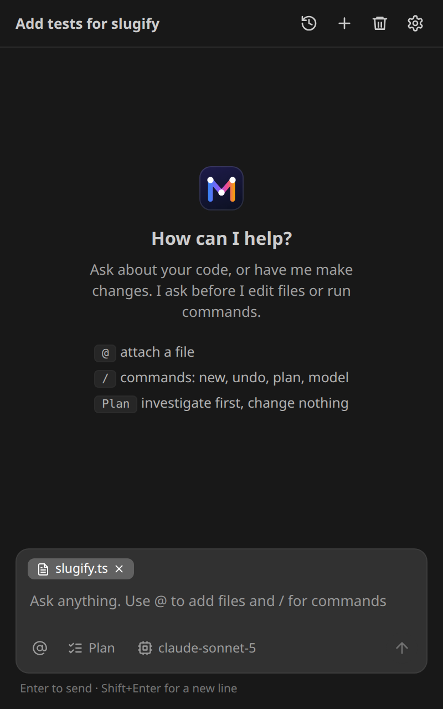
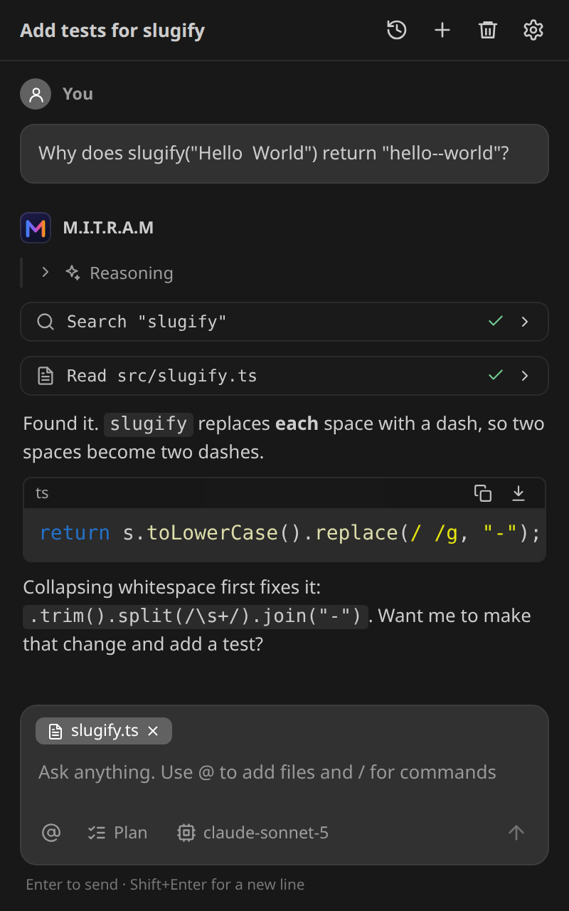
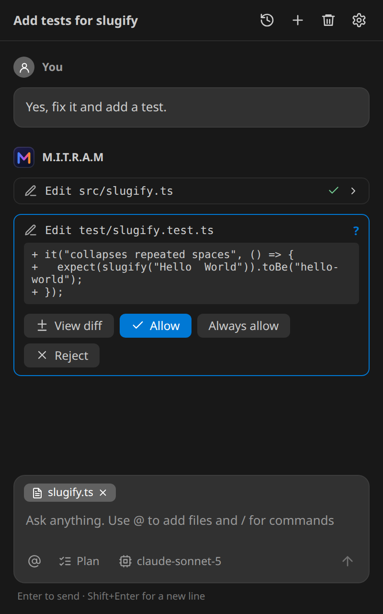
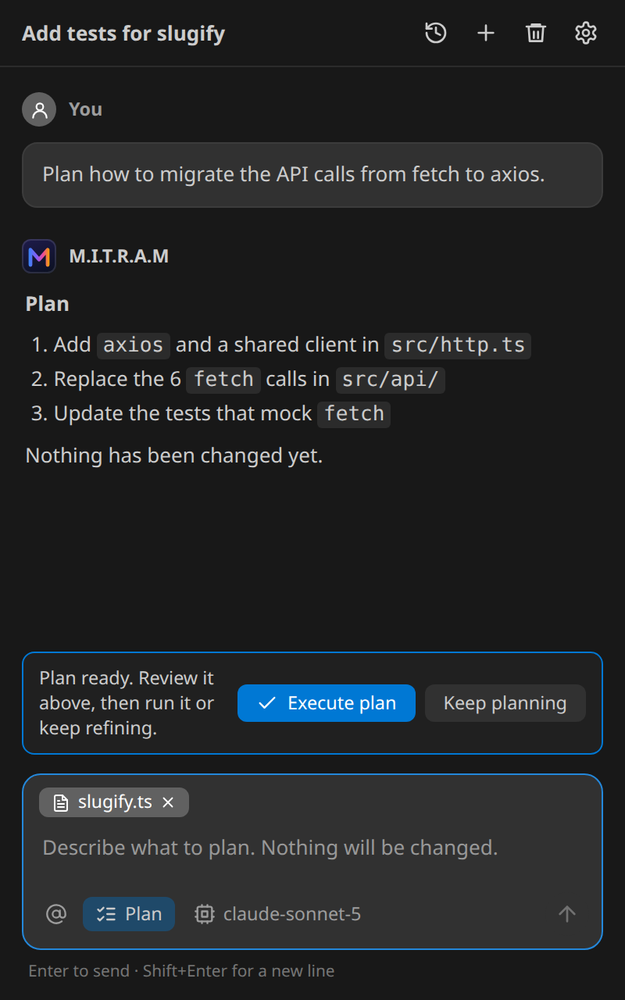
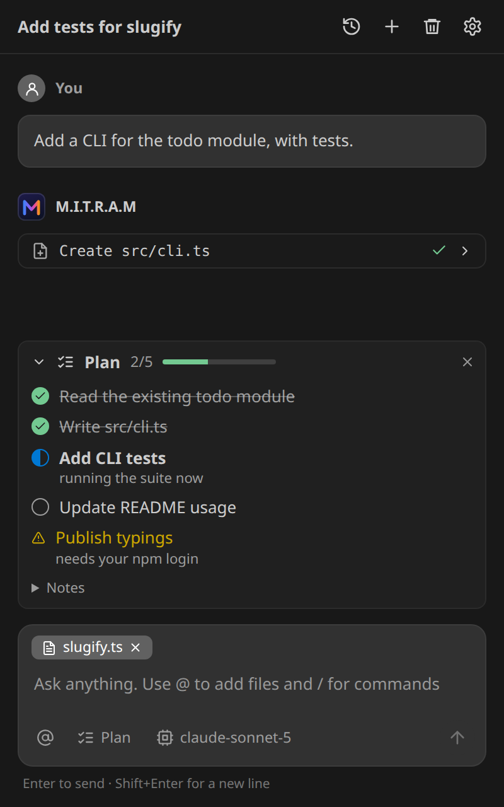
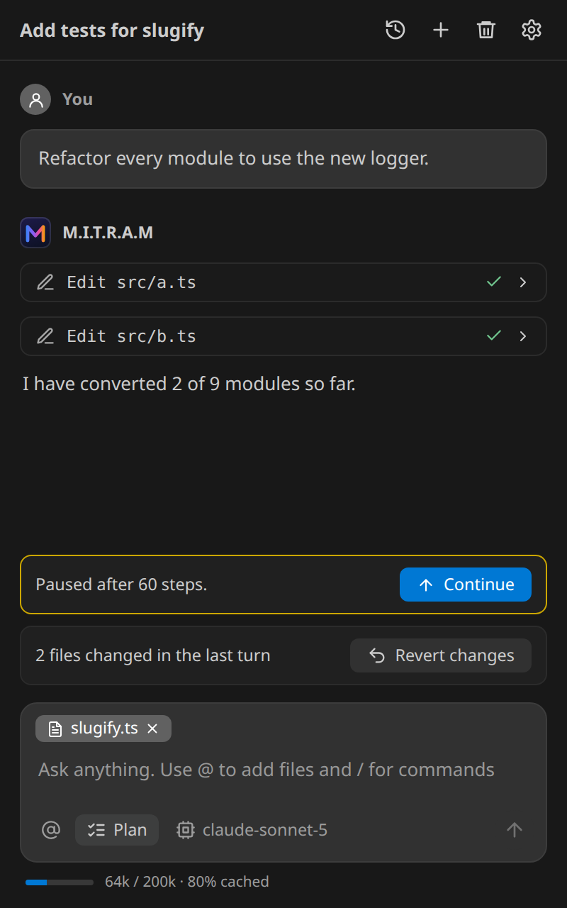
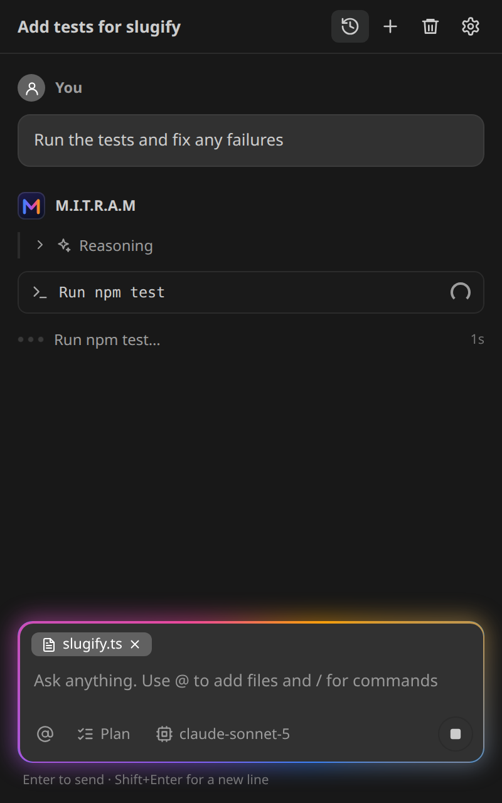
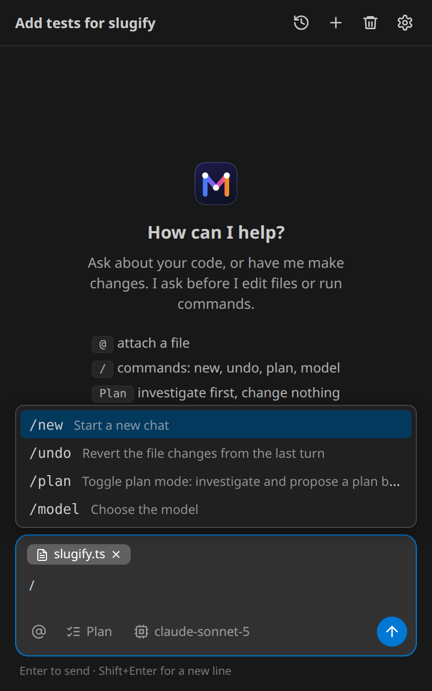
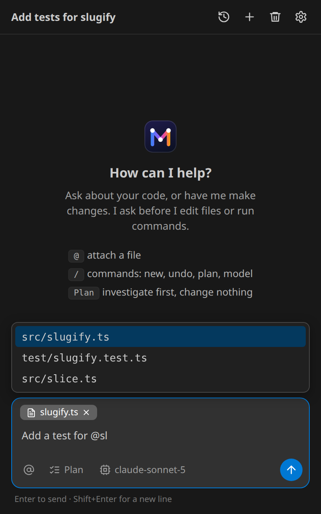
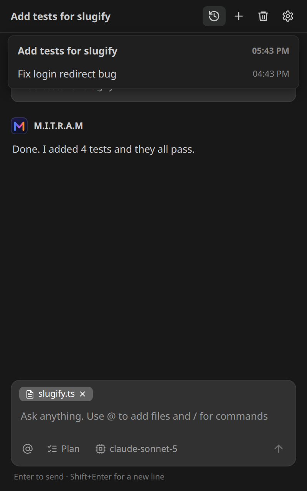

# M.I.T.R.A.M

An AI coding agent in your VS Code sidebar. It can read and search your project, edit files, run commands and fix its own mistakes, while you approve every change that matters.

It talks to **Claude on Azure AI Foundry** using your own endpoint and API key. Nothing goes through any other service.

## Getting started

1. Install the extension and open a **folder** (the agent needs one to work on files).
2. Open your user **Settings** and set `mitram.endpoint` to your Foundry endpoint, for example `https://<resource>.services.ai.azure.com/anthropic/`.
3. Set `mitram.model` to your **deployment name**.
4. Run **M.I.T.R.A.M: Set API Key** from the Command Palette.
5. Click the M.I.T.R.A.M icon in the activity bar (or press `Ctrl+Alt+M` / `Cmd+Alt+M`) and ask for something, such as *"add a unit test for the slugify function and run it"*.

## What it can do

| | |
|---|---|
| Understand code | Reads files, lists folders, searches by name and by regular expression, and reads editor errors |
| Change code | Small exact-match edits and new files, applied through the editor so **Ctrl+Z** works |
| Run things | Runs tests, builds and git commands, and reads the output |
| Plan first | Turn on **Plan** (or type `/plan`) and it only investigates, then proposes a plan you approve |
| Keep track | A **plan board** with task statuses that it updates as it works, so it always knows what is done and what is left |

In the message box: type `@` to attach a file, `/` for commands (`/new`, `/undo`, `/plan`, `/model`, `/permissions`). The current file or selection is attached automatically; untick the chip above the box to stop that.

To show it something, paste a screenshot (**Ctrl+V**), drop files on the box (hold **Shift** while dropping, as VS Code requires), or use **+** → **Attach files…**. Up to 5 images and 5 other files per message:

- **Images** are scaled to what the model can read (2576 px on the long edge, 3.75 megapixels), and re-encoding drops metadata such as a photo's location.
- **PDFs** (up to 15 MB) go to the model as they are, so it sees the pages, including tables and charts.
- **Word, Excel, PowerPoint and LibreOffice files** are sent as the text read from them: documents as paragraphs, spreadsheets as CSV for each sheet (with real dates), presentations slide by slide. Old `.doc`, `.xls` and `.ppt` files need saving in the newer format first.
- **Text files** of any kind (code, CSV, JSON, Markdown, logs) are sent as they are, up to about 200,000 characters each.

File types are recognised from their contents, not their names.

## Feature tour

### A chat that works on your project
Ask about your code or ask for a change. The current file is attached automatically, and the model's reasoning is shown while it works. When a long run of tool calls scrolls your message out of view, it stays pinned at the top of the chat (the request for whatever part you are reading); click it to jump back to the full message.

<p align="center"></p>

### It reads before it answers
The agent searches and reads your files (and your editor's error list) before it replies, and each step is shown as a card you can expand.

<p align="center"></p>

### You approve every change
Edits and commands wait for you. **View diff** opens VS Code's diff editor on the exact change, and **Allow**, **Always allow** or **Reject** decide what happens next.

**Always allow** on a command saves a rule for this workspace, shown on the button before you click it: `npm run lint *` (the script with any arguments) for everyday tools, or just the exact command for interpreters, installs and anything that deletes, pushes or reaches the network. A command with pipes, chaining, redirects or wildcards is saved only exactly as written, character for character, and the card warns you to read all of it first. Type `/permissions` to review or remove saved rules.

<p align="center"></p>

### Plan mode
Turn on **Plan** (or type `/plan`) and the agent only investigates and proposes a plan. Nothing is changed until you press **Execute plan**.

<p align="center"></p>

### A plan board for long tasks
For big jobs the agent keeps a board of tasks (to do, in progress, done, blocked) and notes. It re-reads the board on every step, so it always knows what is finished and what is left.

<p align="center"></p>

### Continue and revert
A long run pauses after a step or time limit and shows **Continue**. A turn that changed files shows **Revert changes**, and the context bar shows how much of the model's window is used and how much came from cache.

<p align="center"></p>

### Live feedback while it works
The message box glows and a status line shows the current step, so you always know whether the agent is working or waiting for you. Press **Esc** or the stop button to cancel.

<p align="center"></p>

### Slash commands and file attachments
Type `/` for commands and `@` to attach files.

<p align="center">&nbsp;&nbsp;</p>

### Chat history
Every chat is saved on your machine. Use the history button to switch between them, or **+** to start a new one.

<p align="center"></p>


## Long tasks

For work with many steps, the agent keeps a **plan board**, shown above the message box with each task marked to do, in progress, done or blocked. The board is shown to the agent again at the end of every request, outside the saved conversation, so it always sees the current plan even after old messages are trimmed. It also keeps short notes there (findings, decisions, the command that runs the tests). The board is saved with the chat. Use the **×** on the panel to clear it.

Things that keep a long run on track:

- **Check before finishing.** If the agent tries to stop with files it changed but never checked, or with tasks still pending, it is sent back to work. It is reminded at most twice, and if something is still open when it finishes you are told what. If you refuse to let a check run, it stops insisting. Turn this off with `mitram.verifyBeforeDone`.
- **Budgets and Continue.** A run pauses after `mitram.maxIterations` steps (default 60) or `mitram.maxRunMinutes` minutes (default 20), and shows a **Continue** button. Continuing keeps the earlier revert point, so the whole task can still be undone with **Revert changes**.
- **Going in circles.** If the same action keeps giving the same result, the agent is told to change approach, and the run stops if it carries on. You can press **Continue** to let it try again.
- **Long conversations.** Near the context limit, old tool output is cleared first. If that is not enough, the oldest part of the conversation is replaced by a short model-written summary (one extra request; turn off with `mitram.summarizeContext`, in which case old turns are dropped).

## You stay in control

- **Approval.** Every edit, new file and command asks first. Edits show a **View diff** button that opens VS Code's diff editor.
- **Blocked outright.** Obviously destructive commands (`sudo`, `rm -rf /`, `curl … | sh`, force-push, and similar) are refused without asking. You can add your own patterns with `mitram.blockedCommandPatterns`. This is a safety net, not a sandbox: the approval prompt is your real protection.
- **Revert.** After a turn that changed files, **Revert changes** restores them. A file you edited yourself afterwards is left alone. Changes made by commands the agent ran are not tracked.
- **Workspace only.** File tools cannot read or write outside the open folder, including through symlinks.
- **Optional auto-approve**, all off by default: `mitram.autoApproveEdits`, `mitram.autoApproveSafeCommands` (`pwd`, `ls`, read-only `git`) and `mitram.autoApproveCommands` (a list of commands you trust in every workspace, each matched as a whole; anything chained with `;`, `&`, `|` or redirects always asks). These are read from your user settings only, so a repository's `.vscode/settings.json` cannot switch them on.
- **Per-project command rules.** **Always allow** on a command card saves a rule in VS Code's storage for this workspace, not in a file a repository could ship. Review them with `/permissions` or **M.I.T.R.A.M: Manage Always-Allowed Commands**.

## Settings

| Setting | What it does |
|---|---|
| `mitram.endpoint` | Your Azure AI Foundry endpoint (user settings only) |
| `mitram.model` / `mitram.models` | Default model (deployment name) and extra names for the picker |
| `mitram.maxTokens` | Maximum tokens per reply |
| `mitram.maxIterations` / `mitram.maxRunMinutes` | Pause a run after this many steps (default 60) or minutes (default 20); a Continue button resumes it |
| `mitram.verifyBeforeDone` | Make the agent check its changes and finish its board before it stops (default on) |
| `mitram.summarizeContext` | Summarise the oldest conversation near the context limit instead of dropping it (default on) |
| `mitram.showReasoning` | Show the model's reasoning summary while it works (default on; falls back automatically if your deployment does not support it) |
| `mitram.contextWindow` | Your deployment's context size. Older context is trimmed above about 70% of it |
| `mitram.promptCaching` | Cache the prompt prefix to cut cost and latency. Turn off if your deployment rejects it |
| `mitram.includeEnvironment` | Send open tabs, git branch and diff summary, and current errors with each message |
| `mitram.autoApprove*`, `mitram.blockedCommandPatterns` | See above |

## Project instructions

Run **M.I.T.R.A.M: Create Project Instructions (MITRAM.md)** to create a `MITRAM.md` in your project root. Its contents are added to the agent's instructions (build and test commands, conventions, things to avoid). They can never override the safety rules or the approval prompts. Read a `MITRAM.md` before trusting it in a project you did not write.

## Privacy

- **No telemetry.** This extension does not collect or send usage data.
- **Where your data goes.** The only network traffic is to the endpoint you configure. It is read from your user settings only, so a repository's `.vscode/settings.json` cannot redirect your requests or API key. Each request contains your message, files, selections and images you attach, the results of tools the agent ran (file contents, command output), the agent's plan board, and, unless you turn it off, the environment summary described above. When a long conversation is summarised, the earlier part of it is sent to the same endpoint to be summarised.
- **Your API key** is kept in VS Code's secret storage and is never written to settings, logs or chat history.
- **Chats** are stored locally in VS Code's extension storage on your machine. To keep that small, saved chats keep the images and PDFs of only their last two messages with them, in your three most recent chats; older images show as "image (not kept)". Text read from attached files is kept like any other attached context.
- **Logs** (`M.I.T.R.A.M: Show Logs`) are local, contain no prompts, file contents or command output, and have anything resembling a credential redacted. **Copy Diagnostics for Bug Report** includes only versions, settings and the endpoint's host name.

## Troubleshooting

- *"No folder is open"*: use **File → Open Folder**. Without one the agent can only chat.
- *404 or "Not found"*: check the endpoint URL, and that `mitram.model` is your deployment name.
- *An error mentioning `cache_control`*: set `mitram.promptCaching` to `false`.
- *The agent says it has no tools*: it is running without a folder, or the model deployment does not support tool use.

## Development

```bash
npm run install:all   # install both packages
npm run build         # extension + webview
npm test              # unit tests (no network)
npm run test:coverage
npm run package       # build a .vsix
```

Press **F5** in this folder to launch a development window with the debugger (it opens `sandbox/` and disables your other extensions).

If the development window's extension host crashes on F5 (exit code 134 in VS Code's `main.log`), start it without the debugger instead: `npm run dev`, or the **Dev window (no debugger)** task. You lose breakpoints, nothing else.

`npm run eval -- --yes` runs 29 end-to-end tasks (including five longer multi-step ones, such as building a module plus a CLI against an existing test, and a change that only the tests reveal is broken) against **your** model and records a pass rate (set `MITRAM_ENDPOINT`, `MITRAM_API_KEY`, and optionally `MITRAM_MODEL`). It spends tokens, so it refuses to start without `--yes`.

## Known limitations

- Claude on Azure AI Foundry only.
- Commands run in a background process, not in a terminal tab.
- Summaries are written by the model, so details can be lost; the plan board and your project files are the reliable memory for long work.
- Not tested on real multi-hour tasks yet. Run `npm run eval` against your deployment to see how it does.
